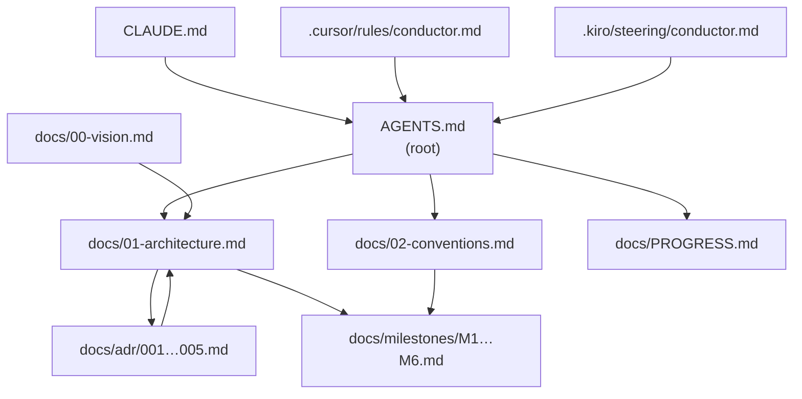
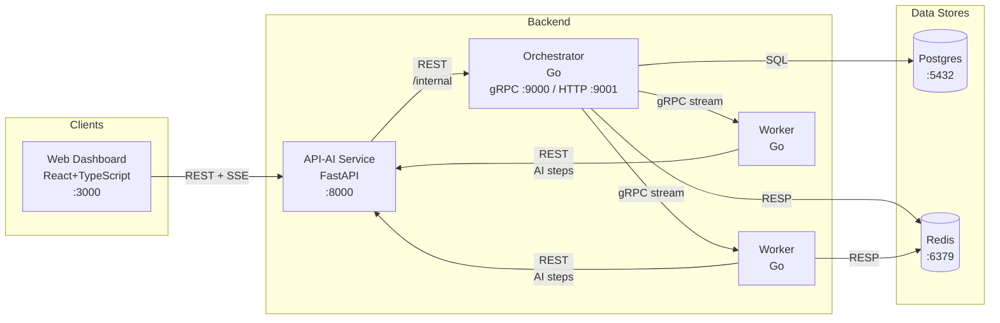
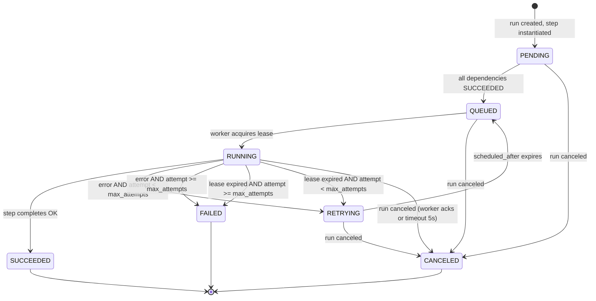

# Design Document

## Overview

The Conductor documentation system is the first-phase deliverable for the Conductor distributed AI workflow orchestrator project. The goal is to produce a complete, tool-neutral documentation corpus that defines the system's architecture, conventions, decision rationale, and delivery roadmap before a single line of application code is written.

The deliverable is a set of markdown files structured in a monorepo. Together they serve as the single authoritative source of truth for AI coding assistants, developers, and stakeholders. No application code, migrations, or container configurations are produced in this phase. Architecture review and explicit approval gate the transition to code.

**Why documentation-first?** Conductor is a distributed system with multiple services, a complex state machine, lease-based scheduling, and failure-recovery semantics. Ambiguities at this layer are expensive to fix after code is written. Capturing architecture decisions, API contracts, and failure handling in reviewable documents before implementation prevents rework.

---

## Architecture

### Documentation File Graph

All documents form a directed dependency graph. Downstream documents incorporate or reference upstream ones.



### Physical Directory Layout

```
/                                   ← repo root
├── AGENTS.md                       ← AI-tool rules (single source of truth)
├── CLAUDE.md                       ← pointer → AGENTS.md
├── .cursor/
│   └── rules/
│       └── conductor.md            ← pointer → AGENTS.md + docs/
├── .kiro/
│   └── steering/
│       └── conductor.md            ← pointer → AGENTS.md + docs/
├── orchestrator/                   ← Go orchestrator (code added post-approval)
│   ├── cmd/
│   │   └── orchestrator/
│   ├── internal/
│   │   ├── dag/
│   │   ├── scheduler/
│   │   ├── statemachine/
│   │   ├── lease/
│   │   └── recovery/
│   ├── migrations/                 ← sole location for Postgres migrations
│   └── Makefile
├── worker/                         ← Go worker (code added post-approval)
│   ├── cmd/
│   │   └── worker/
│   ├── internal/
│   │   ├── executor/
│   │   ├── heartbeat/
│   │   └── registration/
│   └── Makefile
├── api-ai/                         ← Python FastAPI service (code added post-approval)
│   ├── app/
│   │   ├── auth/
│   │   ├── workflows/
│   │   ├── runs/
│   │   ├── ai/
│   │   └── providers/
│   ├── openapi/                    ← OpenAPI spec lives here
│   └── tests/
├── web/                            ← React+TypeScript dashboard (code added post-approval)
│   ├── src/
│   │   ├── components/
│   │   ├── pages/
│   │   └── __tests__/
│   └── package.json
├── shared/
│   └── proto/                      ← Protobuf definitions for gRPC
├── deploy/                         ← Docker Compose + infra (added post-approval)
└── docs/
    ├── 00-vision.md
    ├── 01-architecture.md
    ├── 02-conventions.md
    ├── PROGRESS.md
    ├── adr/
    │   ├── 001-go-for-orchestrator-worker.md
    │   ├── 002-fastapi-for-api-ai.md
    │   ├── 003-lease-based-scheduling.md
    │   ├── 004-postgres-source-of-truth.md
    │   └── 005-redis-queues-pubsub.md
    └── milestones/
        ├── M1.md
        ├── M2.md
        ├── M3.md
        ├── M4.md
        ├── M5.md
        └── M6.md
```

### Conductor System Architecture

The content of `docs/01-architecture.md` must describe the following runtime architecture.



**Inter-service communication matrix:**

| Caller | Callee | Protocol | Direction |
|--------|--------|----------|-----------|
| Web Dashboard | API-AI | HTTP REST | client → server |
| Web Dashboard | API-AI | SSE | server → client (push) |
| API-AI | Orchestrator | HTTP REST (`/internal/`) | client → server |
| Worker | Orchestrator | gRPC bidirectional stream | mutual |
| Worker | API-AI | HTTP REST | client → server (AI steps only) |
| Orchestrator | Postgres | TCP / SQL | client → server |
| Orchestrator | Redis | RESP | client → server |
| Worker | Redis | RESP | client → server |

---

## Components and Interfaces

### 1. AGENTS.md

**Role:** The single source of truth for every AI coding assistant operating in this repo.

**Required sections (in order):**
1. Project Summary (3–6 sentences, ≤ 150 words)
2. Repository Map (ASCII tree, depth 2)
3. Build / Test / Lint / Run commands per service
4. Hard Rules (numbered list)
5. Definition of Done checklist
6. AI Assistant Workflow (read architecture + milestone before coding; update PROGRESS.md after)

**Constraints:** ≤ 100 lines total.

**Hard rules content:**
- All step state transitions MUST go through the `statemachine` package only
- Never edit an already-applied database migration; add a new one
- Every change ships with tests (unit + at minimum one integration test)
- Do not add external dependencies without explicit approval
- Only touch files relevant to the current task
- Do not refactor unrelated code in the same commit

**Definition of Done checklist:**
- [ ] All tests pass (`make test` in affected service)
- [ ] Lint passes (`make lint` in affected service)
- [ ] `docs/PROGRESS.md` updated with completed item and date
- [ ] No changes to files outside the task's stated scope

---

### 2. Tool-Specific Pointer Files

**CLAUDE.md** (≤ 5 lines):
```markdown
# Claude Instructions
Read AGENTS.md at the repository root before doing any work.
AGENTS.md is the single source of truth for project rules and conventions.
```

**.cursor/rules/conductor.md** (≤ 10 lines):
```markdown
# Cursor Rules
Always read AGENTS.md (repo root) and the current milestone spec in docs/milestones/
before generating or modifying code. Follow all rules defined there.
```

**.kiro/steering/conductor.md** (≤ 10 lines):
```markdown
# Kiro Steering
Always read AGENTS.md (repo root) and docs/ before starting any task.
AGENTS.md contains project rules. docs/01-architecture.md contains the system design.
```

**Extension pattern for new tools:** Create `{tool-config-file}` at root or tool-specific config directory. Content: two lines — a directive to read AGENTS.md and the docs/ directory. Never duplicate rule content.

---

### 3. Vision Document (`docs/00-vision.md`)

**Required sections:**
1. What is Conductor? (plain language, ≤ 3 paragraphs)
2. Why does it exist? (problems it solves)
3. Who uses it? (personas + use case table)
4. End-to-end example workflow (PDF → chunk → embed → summarize → merge → output)
5. Success criteria (measurable outcomes)
6. Glossary (terms defined on first use or in this section)

**Tone and format:** Short paragraphs, clear `##` headings, no undefined acronyms. Readable by a non-developer stakeholder.

**Success criteria examples** (to include in the doc):
- A single workflow with 10 steps completes end-to-end within 30 seconds on a 2-worker cluster
- A crashed worker's in-progress tasks are reclaimed and re-run within 60 seconds
- The system can run 100 concurrent workflow executions without job loss
- The web dashboard reflects step state changes within 2 seconds of the state change

---

### 4. Architecture Document (`docs/01-architecture.md`)

This is the most content-rich document. Required sections and their content obligations are specified below.

#### 4.1 Repository Structure

Purpose-description for each top-level directory:

| Directory | Purpose | Primary file types |
|-----------|---------|-------------------|
| `/orchestrator` | Go service: DAG scheduling, state machine, lease management, crash recovery | `.go`, `Makefile`, `migrations/` |
| `/worker` | Go service: task execution, heartbeat, step type handlers | `.go`, `Makefile` |
| `/api-ai` | Python FastAPI: auth, workflow CRUD, AI endpoints, LLM providers | `.py`, `openapi/` |
| `/web` | React+TypeScript dashboard | `.tsx`, `.ts`, `package.json` |
| `/shared` | Protobuf definitions used by all Go services | `.proto` |
| `/deploy` | Docker Compose, env templates (added post-approval) | `.yml`, `.env.example` |
| `/docs` | All documentation | `.md` |

#### 4.2 Data Model

The following tables are the complete Postgres schema. All timestamps are `TIMESTAMPTZ`. All IDs are `UUID` generated with `gen_random_uuid()`.

**`users`**
```sql
id            UUID         PK  DEFAULT gen_random_uuid()
email         TEXT         NOT NULL UNIQUE
password_hash TEXT         NOT NULL
created_at    TIMESTAMPTZ  NOT NULL DEFAULT NOW()
```

**`workflows`**
```sql
id             UUID   PK  DEFAULT gen_random_uuid()
owner_id       UUID   NOT NULL  REFERENCES users(id)
name           TEXT   NOT NULL
description    TEXT
dag_definition JSONB  NOT NULL   -- see DAG JSON schema below
version        INT    NOT NULL DEFAULT 1
created_at     TIMESTAMPTZ NOT NULL DEFAULT NOW()
updated_at     TIMESTAMPTZ NOT NULL DEFAULT NOW()
```

**`workflow_runs`**
```sql
id           UUID   PK  DEFAULT gen_random_uuid()
workflow_id  UUID   NOT NULL  REFERENCES workflows(id)
status       TEXT   NOT NULL  CHECK (status IN ('PENDING','RUNNING','SUCCEEDED','FAILED','CANCELED'))
input        JSONB
output       JSONB
triggered_by UUID   REFERENCES users(id)
started_at   TIMESTAMPTZ NOT NULL DEFAULT NOW()
completed_at TIMESTAMPTZ
error_msg    TEXT
```

**`step_executions`**
```sql
id               UUID   PK  DEFAULT gen_random_uuid()
run_id           UUID   NOT NULL  REFERENCES workflow_runs(id)
step_name        TEXT   NOT NULL
step_type        TEXT   NOT NULL  CHECK (step_type IN ('http','transform','delay','summarize','embed','rag'))
status           TEXT   NOT NULL  CHECK (status IN ('PENDING','QUEUED','RUNNING','SUCCEEDED','FAILED','RETRYING','CANCELED'))
attempt_count    INT    NOT NULL DEFAULT 0
max_attempts     INT    NOT NULL DEFAULT 3
idempotency_key  TEXT   NOT NULL UNIQUE  -- format: {run_id}:{step_name}:{attempt_count}
input            JSONB
output           JSONB
error_msg        TEXT
scheduled_after  TIMESTAMPTZ        -- non-null during RETRYING backoff
started_at       TIMESTAMPTZ
completed_at     TIMESTAMPTZ
UNIQUE (run_id, step_name)
```

**`workers`**
```sql
id                UUID   PK  DEFAULT gen_random_uuid()
hostname          TEXT   NOT NULL
grpc_address      TEXT   NOT NULL
status            TEXT   NOT NULL  CHECK (status IN ('ONLINE','OFFLINE','DRAINING'))
capacity          INT    NOT NULL DEFAULT 10
registered_at     TIMESTAMPTZ NOT NULL DEFAULT NOW()
last_heartbeat_at TIMESTAMPTZ NOT NULL DEFAULT NOW()
```

**`leases`**
```sql
id                 UUID   PK  DEFAULT gen_random_uuid()
step_execution_id  UUID   NOT NULL  REFERENCES step_executions(id) UNIQUE
worker_id          UUID   NOT NULL  REFERENCES workers(id)
acquired_at        TIMESTAMPTZ NOT NULL DEFAULT NOW()
expires_at         TIMESTAMPTZ NOT NULL           -- acquired_at + 30 seconds
renewed_at         TIMESTAMPTZ NOT NULL DEFAULT NOW()
```

**DAG definition JSON schema:**
```json
{
  "steps": [
    {
      "name": "string (unique within workflow)",
      "type": "http | transform | delay | summarize | embed | rag",
      "depends_on": ["step_name", "..."],
      "config": {},
      "timeout_seconds": 300,
      "max_attempts": 3
    }
  ]
}
```

#### 4.3 State Machine



Terminal states: `SUCCEEDED`, `FAILED`, `CANCELED`. All state transitions MUST go through the `statemachine` package; no service may update `step_executions.status` directly via SQL outside that package.

#### 4.4 API Contracts

**Orchestrator gRPC API** (`shared/proto/orchestrator.proto`)

```protobuf
service OrchestratorService {
  // Worker registers and receives a stream of task assignments
  rpc RegisterWorker(RegisterWorkerRequest) returns (stream TaskAssignment);
  // Worker acknowledges task completion or failure
  rpc AckTask(AckTaskRequest) returns (AckTaskResponse);
  // Worker sends periodic heartbeats; receives cancel signals back
  rpc Heartbeat(HeartbeatRequest) returns (HeartbeatResponse);
}

message RegisterWorkerRequest {
  string worker_id = 1;
  string hostname  = 2;
  int32  capacity  = 3;
}
message TaskAssignment {
  string task_id           = 1;
  string step_execution_id = 2;
  string step_type         = 3;
  bytes  config            = 4; // JSON
  bytes  input             = 5; // JSON
  string idempotency_key   = 6;
}
message AckTaskRequest {
  string task_id      = 1;
  string worker_id    = 2;
  string status       = 3; // "SUCCEEDED" | "FAILED"
  bytes  output       = 4; // JSON, optional
  string error_message = 5;
}
message AckTaskResponse { bool success = 1; }
message HeartbeatRequest {
  string          worker_id = 1;
  repeated string task_ids  = 2;
}
message HeartbeatResponse { repeated string canceled_task_ids = 1; }
```

**Orchestrator internal REST API** (HTTP `:9001/internal`)

| Method | Path | Request | Response | Errors |
|--------|------|---------|----------|--------|
| POST | `/internal/runs/{run_id}/cancel` | — | `204 No Content` | 404 run not found |
| GET | `/internal/runs/{run_id}/status` | — | `{"status":"...","step_executions":[...]}` | 404 |
| GET | `/metrics` | — | Prometheus text format | — |

**FastAPI REST API** (HTTP `:8000`)

*Authentication*

| Method | Path | Request body | Response | Errors |
|--------|------|-------------|----------|--------|
| POST | `/auth/register` | `{email, password}` | `{token: string}` | 400 validation, 409 duplicate |
| POST | `/auth/login` | `{email, password}` | `{token: string}` | 401 invalid credentials |
| POST | `/auth/refresh` | Bearer token (header) | `{token: string}` | 401 expired |

*Workflows*

| Method | Path | Request body | Response | Errors |
|--------|------|-------------|----------|--------|
| GET | `/workflows` | — | `[{id, name, description, created_at}]` | 401 |
| POST | `/workflows` | `{name, description, dag_definition}` | `{id}` | 400 invalid DAG, 401 |
| GET | `/workflows/{id}` | — | full workflow object | 401, 404 |
| PUT | `/workflows/{id}` | `{name?, description?, dag_definition?}` | `{id}` | 400, 401, 404 |
| DELETE | `/workflows/{id}` | — | `204` | 401, 404 |

*Runs*

| Method | Path | Request body | Response | Errors |
|--------|------|-------------|----------|--------|
| POST | `/workflows/{id}/runs` | `{input?: object}` | `{run_id}` | 400, 401, 404 |
| GET | `/runs` | — | `[run summary, ...]` | 401 |
| GET | `/runs/{id}` | — | full run with step_executions | 401, 404 |
| DELETE | `/runs/{id}` | — | `204` (cancel) | 401, 404 |
| GET | `/runs/{id}/stream` | — | SSE stream `data: {step_name, status, ...}\n\n` | 401, 404 |

*AI endpoints*

| Method | Path | Request body | Response | Errors |
|--------|------|-------------|----------|--------|
| POST | `/ai/summarize` | `{text, max_length?, model?}` | `{summary, tokens_used}` | 400, 401, 502 |
| POST | `/ai/embed` | `{texts: string[]}` | `{embeddings: float[][], tokens_used}` | 400, 401, 502 |
| POST | `/ai/rag/query` | `{query, collection_id, top_k?: 5}` | SSE stream: `{chunk: string, done: bool}` | 400, 401, 404, 502 |
| GET | `/ai/cost` | — | `{total_tokens, total_cost, by_run: [...]}` | 401 |

*Workers (read-only)*

| Method | Path | Response |
|--------|------|----------|
| GET | `/workers` | `[{id, hostname, status, last_heartbeat_at, capacity}]` |

#### 4.5 Lease-Based Task Assignment

- **Heartbeat interval**: 10 seconds (worker sends heartbeat every 10s)
- **Lease duration**: 30 seconds (`expires_at = acquired_at + 30s`)
- **Reclaim scan interval**: every 15 seconds (orchestrator background goroutine)
- **Reclaim condition**: `leases.expires_at < NOW()` — no heartbeat renewed the lease in time
- **Reclaim action**:
  - `attempt_count < max_attempts` → transition step to `RETRYING`, set `scheduled_after = NOW() + backoff(attempt_count)`
  - `attempt_count >= max_attempts` → transition step to `FAILED`
  - Delete the expired lease row

#### 4.6 Retry Policy

| Parameter | Value |
|-----------|-------|
| Base interval | 1 second |
| Backoff multiplier | 2× |
| Jitter | ±20% of calculated interval (random uniform) |
| Maximum interval cap | 300 seconds |
| Default max attempts | 3 (configurable per step in DAG) |
| Terminal state after exhaustion | `FAILED` |

Backoff formula: `min(base * 2^attempt, max_interval) * uniform(0.8, 1.2)`

A step in `RETRYING` state has `scheduled_after` set. The orchestrator scheduler loop queries `step_executions WHERE status = 'RETRYING' AND scheduled_after <= NOW()` and re-queues those steps.

#### 4.7 Idempotency

- **Key format**: `{run_id}:{step_name}:{attempt_count}`
- **Storage**: `step_executions.idempotency_key` column with `UNIQUE` constraint
- **Duplicate detection**: before creating a new `step_execution` row, the orchestrator attempts an `INSERT ... ON CONFLICT DO NOTHING` keyed on `(run_id, step_name)`. If a row exists, it reuses the existing execution.
- **AI endpoint deduplication**: the API-AI service checks the `idempotency_key` header on POST `/ai/summarize` and `/ai/embed`. If a cached result exists (stored in Redis for 24 hours), it returns the cached response without calling the LLM.

#### 4.8 Timeouts, Cancellation, and Rate Limiting

**Timeouts:**
- Default step timeout: 300 seconds (configurable per step as `timeout_seconds` in DAG)
- LLM call timeout: 120 seconds
- Cancellation ack timeout: 5 seconds (before worker is considered unresponsive and step is force-canceled)

**Cancellation sequence:**
1. Client calls `DELETE /runs/{id}` or `POST /internal/runs/{id}/cancel`
2. Orchestrator sets `workflow_runs.status = 'CANCELED'`
3. `PENDING`, `QUEUED`, `RETRYING` steps → set to `CANCELED` immediately
4. `RUNNING` steps → send cancel signal in `HeartbeatResponse.canceled_task_ids`
5. Worker stops step execution, calls `AckTask` with `status = "CANCELED"`
6. Orchestrator sets step to `CANCELED`; if no ack within 5 seconds, force-sets to `CANCELED`

**Rate limiting (LLM calls):**
- 60 requests per minute per workflow (sliding window, enforced in API-AI service)
- Token bucket implementation in Redis (key: `ratelimit:workflow:{workflow_id}`)
- Exceeded rate limit → HTTP 429 to caller, worker backs off and retries after `Retry-After` header value

#### 4.9 Crash Recovery

On orchestrator process restart:

```sql
-- Step 1: find all non-terminal steps
SELECT * FROM step_executions
WHERE status IN ('QUEUED', 'RUNNING', 'RETRYING');

-- Step 2: for RUNNING steps, check for valid lease
SELECT se.id FROM step_executions se
LEFT JOIN leases l ON l.step_execution_id = se.id
WHERE se.status = 'RUNNING'
  AND (l.id IS NULL OR l.expires_at < NOW());
-- → transition these to RETRYING (if attempts < max) or FAILED
```

Recovery actions:
1. `RUNNING` with no valid lease → `RETRYING` or `FAILED` (per retry policy)
2. `QUEUED` → re-push `step_execution_id` to Redis task queue `conductor:tasks`
3. `RETRYING` with `scheduled_after <= NOW()` → re-push to Redis task queue
4. Resume normal scheduler and reclaim loops

#### 4.10 Failure Scenarios

| Failure | Detection | System Response |
|---------|-----------|-----------------|
| Worker process crash | Lease expires (no heartbeat for 30s) | Reclaim scan transitions step to `RETRYING` or `FAILED`; task re-queued if retries remain |
| Network partition (worker isolated) | Same as crash — lease expiry | Same as above |
| Orchestrator restart | — | Recovery procedure (§4.9): re-queue `QUEUED`/expired `RUNNING`; retry pending `RETRYING` |
| Redis failure | Redis connection error | Orchestrator switches to Postgres-only polling mode; re-queues from DB on Redis recovery |
| Postgres failure | Connection error | Orchestrator and API-AI return 503; workers drain; alert via Prometheus alert rule |
| Duplicate task delivery | Idempotency key unique constraint | Duplicate insert ignored; cached AI result returned |
| Step timeout | Orchestrator timer per execution | Worker receives cancel signal; step transitions to `FAILED` (no retries for timeout exhaustion) |

#### 4.11 Orchestrator Service Responsibilities

| Responsibility | Purpose | Observable behavior |
|---------------|---------|-------------------|
| DAG parsing | Parse `dag_definition` JSON, build dependency graph | Returns validation error if cycles detected or unknown step types |
| Scheduling | Advance `PENDING` steps to `QUEUED` when all dependencies `SUCCEEDED` | Steps appear in Redis queue within 1s of dependency completion |
| State persistence | Write all state transitions to Postgres via `statemachine` package | Every transition is durable; survives restart |
| Lease management | Issue and renew leases; reclaim expired ones | Expired tasks re-queued within `reclaim_scan_interval + lease_duration` |
| Retry logic | Exponential backoff with jitter; track attempt counts | Step auto-retries up to `max_attempts`; dead-letters to `FAILED` |
| Crash recovery | Re-hydrate queues from Postgres on startup | No tasks permanently lost after restart |
| Timeouts | Per-step timer; cancel signal to worker on expiry | Step transitions to `FAILED` if worker doesn't ack within `cancellation_ack_timeout` |
| Cancellation | Cancel signal on DELETE/cancel requests | All non-terminal steps reach `CANCELED` within 10s |
| Rate limiting | LLM request rate limiter per workflow | Returns 429 when budget exceeded |
| Event emission | Publish step state changes to Redis pub/sub channel `conductor:events:{run_id}` | SSE subscribers receive updates within 500ms |

#### 4.12 Worker Service Responsibilities

| Responsibility | Purpose | Observable behavior |
|---------------|---------|-------------------|
| Registration | Connect to orchestrator gRPC, send `RegisterWorkerRequest` | Appears in `workers` table with `ONLINE` status |
| Task streaming | Receive `TaskAssignment` from orchestrator stream | Executes tasks as they arrive; no polling loop |
| Heartbeat | Send `HeartbeatRequest` every 10s with active task IDs | `workers.last_heartbeat_at` updated; `leases.renewed_at` updated |
| Step execution – http | HTTP call per step config, capture response | Output JSON stored in `step_executions.output` |
| Step execution – transform | In-process JSONata/jq transform | Deterministic, no external calls |
| Step execution – delay | Sleep for `config.duration_seconds` | Step moves to `SUCCEEDED` after delay |
| Step execution – AI types | Call API-AI REST endpoint with `idempotency_key` header | Delegates to API-AI; passes response back as output |
| Graceful shutdown | On SIGTERM: drain current tasks, stop accepting new ones | No new tasks accepted; in-flight tasks complete or time out |
| Concurrency | `capacity` goroutines run simultaneously | Configurable via `WORKER_CAPACITY` env var (default 10) |

#### 4.13 API-AI Service Responsibilities

| Responsibility | Purpose | Observable behavior |
|---------------|---------|-------------------|
| JWT auth | Issue and verify JWT tokens | All non-auth endpoints return 401 without valid Bearer token |
| Workflow CRUD | Persist workflow definitions | Stored in Postgres; returned in list/get responses |
| Run triggering | Call orchestrator to start a run | Returns `run_id`; orchestrator creates step_executions |
| Run history | Query `workflow_runs` + `step_executions` | Paginated list and detail endpoints |
| AI – summarize | Call LLM with summarize prompt | Returns `{summary, tokens_used}` |
| AI – embed | Call embedding model | Returns `{embeddings: float[][], tokens_used}` |
| AI – RAG query | Retrieve chunks + stream LLM response | SSE stream with `{chunk, done}` frames |
| LLM provider interface | Abstract over OpenAI, Anthropic, etc. | Provider selected via `LLM_PROVIDER` env var; same API surface |
| Token/cost tracking | Record tokens used per step execution | Queryable via `GET /ai/cost` |
| SSE event stream | Push step state changes to web clients | Uses Redis pub/sub → SSE fan-out |

#### 4.14 Web Dashboard Responsibilities

| Responsibility | Purpose | Observable behavior |
|---------------|---------|-------------------|
| Drag-and-drop workflow builder | Visually compose DAGs | Nodes represent steps; edges represent dependencies; exports as DAG JSON |
| Live run viewer | Show step states in real time | SSE connection to `/runs/{id}/stream`; states update without page refresh |
| Run history | Browse past executions | Filterable list; click through to step detail |
| Cost/latency dashboard | Operational metrics per workflow | Charts for tokens used, cost, p50/p99 step latency |
| Worker status page | Monitor live worker pool | Table with hostname, status, heartbeat age, capacity |

---

## Components and Interfaces — Document Templates

### ADR Template (docs/adr/)

Each ADR file MUST follow this structure and naming: `NNN-short-title.md` where `NNN` is a zero-padded three-digit sequence number. Maximum 500 words.

```markdown
# NNN — Short Title

**Status:** proposed | accepted | deprecated | superseded by [NNN]

## Context

[Problem being addressed. Background information.]

## Decision

[The chosen approach and its rationale.]

## Consequences

**Positive:**
- ...

**Negative:**
- ...
```

**Required initial ADRs:**

| File | Topic | Key decision |
|------|-------|-------------|
| `001-go-for-orchestrator-worker.md` | Language choice | Go chosen for orchestrator and worker for performance, native goroutine concurrency model, gRPC first-class support, and static compilation for small Docker images |
| `002-fastapi-for-api-ai.md` | API language | Python FastAPI chosen for API-AI because the Python LLM SDK ecosystem (OpenAI, LangChain, sentence-transformers) is the most mature; FastAPI provides automatic OpenAPI generation and async support |
| `003-lease-based-scheduling.md` | Scheduling model | Lease + heartbeat chosen over simple polling to prevent duplicate execution; polling requires distributed locks; leases are proven in systems like Temporal and SQS |
| `004-postgres-source-of-truth.md` | Primary data store | Postgres chosen as sole source of truth because DAG execution state requires ACID transactions; the relational model maps naturally to workflows/runs/steps; strong consistency is required for the state machine |
| `005-redis-queues-pubsub.md` | Message transport | Redis chosen for task queues (List RPUSH/BLPOP) and pub/sub (PUBLISH/SUBSCRIBE) for SSE fan-out; low-latency; operationally simpler than Kafka for this scale |

### Milestone Spec Template (docs/milestones/)

Each milestone MUST include the following sections. Acceptance criteria must be binary-verifiable.

```markdown
# Milestone N — Title

## Goal
[1–3 sentences describing what this milestone delivers]

## Scope
- [bulleted list of in-scope items]

## Non-Goals
- [minimum 2 items explicitly out of scope]

## Acceptance Criteria
1. [binary-verifiable criterion]
2. ...

## Tasks
1. [ ] ...
[5–10 tasks]
```

**Milestone content map:**

| File | Goal | Scope highlights |
|------|------|-----------------|
| M1.md | Single-worker linear job execution | Orchestrator + one Worker, linear DAGs (no branches), Postgres state, gRPC streaming |
| M2.md | Reliable DAG execution with fault tolerance | DAG branching/fan-out, retries, heartbeats, lease reclaim, crash recovery |
| M3.md | AI step types via FastAPI | FastAPI integration, `summarize` and `embed` step types, JWT auth, idempotency key |
| M4.md | Live run viewer | React run viewer with SSE/WebSocket, real-time step state updates, run history |
| M5.md | Visual workflow builder + RAG | Drag-and-drop builder, RAG query step type, end-to-end RAG example workflow |
| M6.md | Hardening and observability | Chaos testing (kill workers mid-run), Prometheus metrics, OpenTelemetry traces, documentation finalization |

### Progress Document Template (docs/PROGRESS.md)

```markdown
# Progress

## Done
<!-- Completed items with date -->

## In Progress
<!-- Items currently being worked on -->

## Next
<!-- Upcoming items -->

## Known Issues
<!-- Blocking problems with impact description -->

## Open Questions
<!-- Decisions or clarifications needed -->
```

**Initial state** (documentation-first phase): "In Progress" should list all 12 documentation requirements. "Next" should list M1 implementation (pending architecture approval).

---

## Data Models

### Conventions Document Schema

The conventions document (`docs/02-conventions.md`) is not free-form — it must define the following categories:

| Category | Required content |
|----------|-----------------|
| Go naming | `camelCase` functions/variables, `PascalCase` exported, `snake_case` package names (single word preferred), `ALL_CAPS` constants |
| Python naming | `snake_case` functions/variables, `PascalCase` classes, `SCREAMING_SNAKE_CASE` constants, `kebab-case` module file names |
| TypeScript naming | `camelCase` functions/variables, `PascalCase` components/classes/interfaces, `SCREAMING_SNAKE_CASE` env constants |
| Database naming | `snake_case` tables and columns, plural table names, `{table}_{column}_fk` foreign key names, `{table}_{column}_idx` index names |
| Error handling – Go | Wrap errors with `%w` and `fmt.Errorf`; define sentinel errors in `errors.go`; use `errors.Is`/`errors.As` for matching; propagate gRPC status codes |
| Error handling – Python | Use custom exception hierarchy; HTTP 4xx for client errors, 5xx for server errors; log exception context with structlog |
| Error handling – TypeScript | Typed error responses; error boundaries in React; no unhandled promise rejections |
| Logging format | JSON; required fields: `timestamp` (RFC3339), `level`, `service`, `trace_id`, `span_id`, `msg` |
| Test standards | Go: ≥ 80% unit coverage; Python: ≥ 80%; TypeScript: ≥ 70%; integration tests for every public API endpoint; `*_test.go` alongside source, `tests/` for Python, `__tests__/` or `*.test.ts` for TypeScript |
| Git workflow | Branch format: `{type}/{issue-id}-short-description`; Conventional Commits (`feat:`, `fix:`, `chore:`, etc.); PRs require 1 reviewer + CI green; squash merge |
| Prometheus metrics | Metric names: `conductor_{service}_{metric}_{unit}`; mandatory: request latency histogram, error rate counter, throughput counter per service |
| OpenTelemetry | Span names: `{service}.{operation}`; required headers: `traceparent`, `tracestate`; mandatory spans: service entry points, all external/DB/Redis calls |

---

## Correctness Properties

*A property is a characteristic or behavior that should hold true across all valid executions of a system — essentially, a formal statement about what the system should do. Properties serve as the bridge between human-readable specifications and machine-verifiable correctness guarantees.*

### Property 1: Valid State Machine Transitions

*For any* step execution, every status transition SHALL be one of the explicitly defined edges in the state machine graph; no step execution SHALL ever be assigned a status that is not reachable from its prior status via a defined transition.

**Validates: Requirements 4.3**

### Property 2: DAG Dependency Ordering

*For any* workflow run and any step S with one or more declared dependencies, step S SHALL NOT transition to `QUEUED` or `RUNNING` unless every declared dependency has status `SUCCEEDED`.

**Validates: Requirements 4.2, 12.1**

### Property 3: Lease Exclusivity

*For any* step execution, at most one lease row SHALL exist in the `leases` table with a non-expired `expires_at` at any given point in time; two workers SHALL NOT concurrently hold a valid lease for the same step execution.

**Validates: Requirements 4.7**

### Property 4: Idempotency

*For any* idempotency key, executing the corresponding operation more than once SHALL produce identical observable side effects as executing it exactly once; duplicate invocations SHALL NOT create additional `step_execution` rows, trigger additional LLM calls, or modify outputs already persisted under that key.

**Validates: Requirements 4.9**

### Property 5: At-Least-Once Terminal Delivery

*For any* step execution that has transitioned to `RUNNING`, it SHALL eventually reach one of the terminal states `SUCCEEDED`, `FAILED`, or `CANCELED`; no step execution SHALL remain permanently in a non-terminal state.

**Validates: Requirements 4.6, 4.7**

### Property 6: Retry Bound

*For any* step execution, `attempt_count` SHALL NOT exceed `max_attempts` before the step transitions to the terminal state `FAILED`; the system SHALL NOT enqueue or initiate a further retry attempt once `attempt_count >= max_attempts`.

**Validates: Requirements 4.8**

---

## Error Handling

### Documentation Validation Errors

The following conditions constitute validation failures. These should be surfaced via a validation script (see Testing Strategy) that CI can run.

| Condition | Error message | Severity |
|-----------|--------------|----------|
| `AGENTS.md` missing | `MISSING: AGENTS.md not found at repository root` | Fatal |
| Any of docs/00-vision.md, docs/01-architecture.md, docs/02-conventions.md, docs/PROGRESS.md missing | `MISSING: {file} not found` | Fatal |
| Any milestone M1.md–M6.md missing | `MISSING: docs/milestones/{file} not found` | Fatal |
| Any ADR 001–005 missing | `MISSING: docs/adr/{file} not found` | Fatal |
| AGENTS.md exceeds 100 lines | `CONSTRAINT VIOLATION: AGENTS.md has {n} lines (max 100)` | Error |
| CLAUDE.md exceeds 5 lines | `CONSTRAINT VIOLATION: CLAUDE.md has {n} lines (max 5)` | Error |
| Application code detected (`*.go`, `*.py`, `*.ts`, `*.js`, `*.sh`) | `POLICY VIOLATION: application code found in {path}; architecture approval required` | Fatal |
| Docker/migration files detected | `POLICY VIOLATION: {file} found; not permitted before architecture approval` | Fatal |
| Required section missing from a document | `CONTENT: {file} is missing required section "{section}"` | Error |

### Approval Gate

Before any application code is generated:
1. All Fatal/Error validation checks must pass (zero errors)
2. A stakeholder must provide explicit written approval (recorded in docs/PROGRESS.md under "Done" with date and approver name)
3. Once recorded, the orchestration system may proceed to M1 implementation

If code is requested before approval: respond with "Architecture approval is required before generating application code. Please review docs/01-architecture.md and record approval in docs/PROGRESS.md."

---

## Testing Strategy

PBT is not applicable to this feature. The deliverable consists of documentation files with structural and content constraints. The appropriate testing approach is a **documentation validation script** that can be run in CI.

### Validation Script Design

A `docs/validate.sh` (or `docs/validate.py`) script should perform the following checks. These tests are example-based and smoke-based — not property-based.

**Smoke checks (file existence):**
```
docs/00-vision.md         exists?
docs/01-architecture.md   exists?
docs/02-conventions.md    exists?
docs/PROGRESS.md          exists?
docs/adr/001-*.md         exists?
docs/adr/002-*.md         exists?
docs/adr/003-*.md         exists?
docs/adr/004-*.md         exists?
docs/adr/005-*.md         exists?
docs/milestones/M1.md     exists?
docs/milestones/M2.md     exists?
docs/milestones/M3.md     exists?
docs/milestones/M4.md     exists?
docs/milestones/M5.md     exists?
docs/milestones/M6.md     exists?
AGENTS.md                 exists?
CLAUDE.md                 exists?
.cursor/rules/conductor.md     exists?
.kiro/steering/conductor.md    exists?
```

**Constraint checks (content validation):**
```
AGENTS.md line count         <= 100
CLAUDE.md line count         <= 5
.cursor/rules/conductor.md   <= 10
.kiro/steering/conductor.md  <= 10
docs/adr/*.md word count     <= 500 each
docs/PROGRESS.md contains:  ## Done, ## In Progress, ## Next, ## Known Issues, ## Open Questions
```

**Section presence checks (key headings exist):**

For `docs/01-architecture.md`, assert these headings are present:
- Repository Structure
- Data Model
- State Machine
- API Contracts
- Lease-Based Task Assignment
- Retry Policy
- Idempotency
- Timeouts and Cancellation
- Crash Recovery
- Failure Scenarios

For each milestone `M1.md–M6.md`, assert these headings are present:
- Goal
- Scope
- Non-Goals
- Acceptance Criteria
- Tasks

For each ADR file, assert these headings are present:
- Status
- Context
- Decision
- Consequences

**Policy enforcement check (no application code):**

```bash
# Fail if any of these exist in the repo root or service directories
find . \( -name "*.go" -o -name "*.py" -o -name "*.ts" -o -name "*.js" \
          -o -name "*.sh" -o -name "docker-compose*.yml" -o -name "Dockerfile*" \
          -o -name "*.sql" \) \
  -not -path "./.git/*" \
  -not -path "./docs/*" \
  -not -path "./.kiro/*" \
  -not -path "./.cursor/*"
```

### Manual Review Checklist

Before submitting for architecture approval:

- [ ] All smoke checks pass
- [ ] All constraint checks pass
- [ ] `docs/01-architecture.md` state machine diagram renders correctly in GitHub Markdown preview
- [ ] `docs/01-architecture.md` system architecture Mermaid diagram renders correctly
- [ ] All ADRs have `Status: accepted`
- [ ] All milestone acceptance criteria are binary-verifiable (no subjective language)
- [ ] AGENTS.md hard rules cover all six listed rules
- [ ] `docs/PROGRESS.md` "In Progress" reflects documentation phase; "Next" shows M1

### Post-Approval Testing Strategy (Preview for Code Phase)

When code is written (M1 onward), testing strategy per service:

**Orchestrator (Go):**
- Unit tests: state machine transitions (`*_test.go` alongside each package), DAG parser, backoff calculator, idempotency key generator
- Integration tests: full scheduler loop with embedded Postgres (testcontainers-go), lease reclaim scenario, crash recovery replay
- Minimum 80% unit coverage

**Worker (Go):**
- Unit tests: each step executor (`http`, `transform`, `delay`), heartbeat sender
- Integration tests: worker + mock orchestrator gRPC server, full task lifecycle
- Minimum 80% unit coverage

**API-AI (Python):**
- Unit tests: auth JWT issue/verify, DAG validation, token cost calculation (in `tests/`)
- Integration tests: all REST endpoints with test database, mock LLM provider
- Minimum 80% unit coverage

**Web (TypeScript):**
- Unit tests: DAG validation utilities, cost formatting functions (`*.test.ts`)
- Component tests: run viewer SSE reconnect logic, workflow builder DAG export
- Minimum 70% unit coverage
