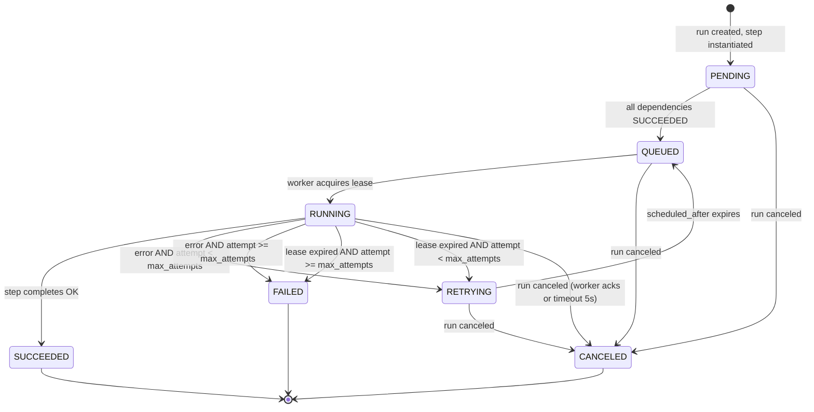
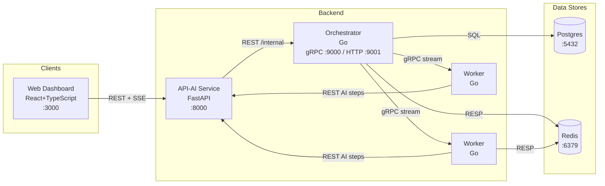

# Architecture

## Repository Structure

Each top-level directory has a single responsibility. The table below maps directories to their purpose and primary file types.

| Directory | Purpose | Primary file types |
|-----------|---------|-------------------|
| `/orchestrator` | Go service: DAG scheduling, state machine, lease management, crash recovery | `.go`, `Makefile`, `migrations/` |
| `/worker` | Go service: task execution, heartbeat, step type handlers | `.go`, `Makefile` |
| `/api-ai` | Python FastAPI: auth, workflow CRUD, AI endpoints, LLM providers | `.py`, `openapi/` |
| `/web` | React+TypeScript dashboard | `.tsx`, `.ts`, `package.json` |
| `/shared` | Protobuf definitions used by all Go services | `.proto` |
| `/deploy` | Docker Compose, env templates (added post-approval) | `.yml`, `.env.example` |
| `/docs` | All documentation | `.md` |

### Canonical Locations

- **Database migrations** — `/orchestrator/migrations/` is the single source of schema changes. Never place migration files elsewhere, and never edit an already-applied migration; add a new file instead.
- **OpenAPI specs** — `/api-ai/openapi/` is the authoritative location for all OpenAPI specification files.
- **Proto/schema definitions** — `/shared/proto/` is the authoritative location for all Protobuf definitions consumed by Go services.

### Test File Locations

| Service type | Convention |
|---|---|
| Go services (`/orchestrator`, `/worker`) | `*_test.go` files alongside the source files they test |
| Python services (`/api-ai`) | `tests/` subdirectory within the service root |
| TypeScript services (`/web`) | `__tests__/` directory or `*.test.ts` files alongside the source files they test |

## Data Model

All timestamps are `TIMESTAMPTZ`. All IDs are `UUID` generated with `gen_random_uuid()`.

### `users`

```sql
id            UUID         PK  DEFAULT gen_random_uuid()
email         TEXT         NOT NULL UNIQUE
password_hash TEXT         NOT NULL
created_at    TIMESTAMPTZ  NOT NULL DEFAULT NOW()
```

### `workflows`

```sql
id             UUID        PK  DEFAULT gen_random_uuid()
owner_id       UUID        NOT NULL  REFERENCES users(id)
name           TEXT        NOT NULL
description    TEXT
dag_definition JSONB       NOT NULL
version        INT         NOT NULL DEFAULT 1
created_at     TIMESTAMPTZ NOT NULL DEFAULT NOW()
updated_at     TIMESTAMPTZ NOT NULL DEFAULT NOW()
```

### `workflow_runs`

```sql
id           UUID        PK  DEFAULT gen_random_uuid()
workflow_id  UUID        NOT NULL  REFERENCES workflows(id)
status       TEXT        NOT NULL  CHECK (status IN ('PENDING','RUNNING','SUCCEEDED','FAILED','CANCELED'))
input        JSONB
output       JSONB
triggered_by UUID        REFERENCES users(id)
started_at   TIMESTAMPTZ NOT NULL DEFAULT NOW()
completed_at TIMESTAMPTZ
error_msg    TEXT
```

### `step_executions`

```sql
id               UUID        PK  DEFAULT gen_random_uuid()
run_id           UUID        NOT NULL  REFERENCES workflow_runs(id)
step_name        TEXT        NOT NULL
step_type        TEXT        NOT NULL  CHECK (step_type IN ('http','transform','delay','summarize','embed','rag'))
status           TEXT        NOT NULL  CHECK (status IN ('PENDING','QUEUED','RUNNING','SUCCEEDED','FAILED','RETRYING','CANCELED'))
attempt_count    INT         NOT NULL DEFAULT 0
max_attempts     INT         NOT NULL DEFAULT 3
idempotency_key  TEXT        NOT NULL UNIQUE  -- format: {run_id}:{step_name}:{attempt_count}
input            JSONB
output           JSONB
error_msg        TEXT
scheduled_after  TIMESTAMPTZ
started_at       TIMESTAMPTZ
completed_at     TIMESTAMPTZ
UNIQUE (run_id, step_name)
```

### `workers`

```sql
id                UUID        PK  DEFAULT gen_random_uuid()
hostname          TEXT        NOT NULL
grpc_address      TEXT        NOT NULL
status            TEXT        NOT NULL  CHECK (status IN ('ONLINE','OFFLINE','DRAINING'))
capacity          INT         NOT NULL DEFAULT 10
registered_at     TIMESTAMPTZ NOT NULL DEFAULT NOW()
last_heartbeat_at TIMESTAMPTZ NOT NULL DEFAULT NOW()
```

### `leases`

```sql
id                 UUID        PK  DEFAULT gen_random_uuid()
step_execution_id  UUID        NOT NULL  REFERENCES step_executions(id) UNIQUE
worker_id          UUID        NOT NULL  REFERENCES workers(id)
acquired_at        TIMESTAMPTZ NOT NULL DEFAULT NOW()
expires_at         TIMESTAMPTZ NOT NULL  -- acquired_at + 30 seconds
renewed_at         TIMESTAMPTZ NOT NULL DEFAULT NOW()
```

### DAG Definition JSON Schema

The `dag_definition` column in `workflows` stores a JSON object conforming to this schema:

```json
{
  "steps": [
    {
      "name": "string (unique within workflow)",
      "type": "http | transform | delay | summarize | embed | rag",
      "depends_on": ["step_name", "..."],
      "config": {},
      "timeout_seconds": 300,
      "max_attempts": 3
    }
  ]
}
```

## State Machine

The diagram below shows every valid state a `step_executions` row can occupy and every labeled transition between states.



**Terminal states:** `SUCCEEDED`, `FAILED`, and `CANCELED`. A step execution in any of these states will never transition again.

> **Constraint (Requirements 4.3):** All state transitions MUST go through the `statemachine` package. No service may update `step_executions.status` directly via SQL outside that package.

## API Contracts

### Orchestrator gRPC API

```protobuf
service OrchestratorService {
  rpc RegisterWorker(RegisterWorkerRequest) returns (stream TaskAssignment);
  rpc AckTask(AckTaskRequest) returns (AckTaskResponse);
  rpc Heartbeat(HeartbeatRequest) returns (HeartbeatResponse);
}

message RegisterWorkerRequest {
  string worker_id = 1;
  string hostname  = 2;
  int32  capacity  = 3;
}
message TaskAssignment {
  string task_id           = 1;
  string step_execution_id = 2;
  string step_type         = 3;
  bytes  config            = 4;
  bytes  input             = 5;
  string idempotency_key   = 6;
}
message AckTaskRequest {
  string task_id       = 1;
  string worker_id     = 2;
  string status        = 3;
  bytes  output        = 4;
  string error_message = 5;
}
message AckTaskResponse { bool success = 1; }
message HeartbeatRequest {
  string          worker_id = 1;
  repeated string task_ids  = 2;
}
message HeartbeatResponse { repeated string canceled_task_ids = 1; }
```

### Orchestrator Internal REST API (`:9001/internal`)

| Method | Path | Request | Response | Errors |
|--------|------|---------|----------|--------|
| POST | `/internal/runs/{run_id}/cancel` | — | `204 No Content` | 404 run not found |
| GET | `/internal/runs/{run_id}/status` | — | `{"status":"...","step_executions":[...]}` | 404 |
| GET | `/metrics` | — | Prometheus text format | — |

### FastAPI REST API (`:8000`)

**Authentication:**

| Method | Path | Request body | Response | Errors |
|--------|------|-------------|----------|--------|
| POST | `/auth/register` | `{email, password}` | `{token: string}` | 400 validation, 409 duplicate |
| POST | `/auth/login` | `{email, password}` | `{token: string}` | 401 invalid credentials |
| POST | `/auth/refresh` | Bearer token (header) | `{token: string}` | 401 expired |

**Workflows:**

| Method | Path | Request body | Response | Errors |
|--------|------|-------------|----------|--------|
| GET | `/workflows` | — | `[{id, name, description, created_at}]` | 401 |
| POST | `/workflows` | `{name, description, dag_definition}` | `{id}` | 400 invalid DAG, 401 |
| GET | `/workflows/{id}` | — | full workflow object | 401, 404 |
| PUT | `/workflows/{id}` | `{name?, description?, dag_definition?}` | `{id}` | 400, 401, 404 |
| DELETE | `/workflows/{id}` | — | `204` | 401, 404 |

**Runs:**

| Method | Path | Request body | Response | Errors |
|--------|------|-------------|----------|--------|
| POST | `/workflows/{id}/runs` | `{input?: object}` | `{run_id}` | 400, 401, 404 |
| GET | `/runs` | — | `[run summary, ...]` | 401 |
| GET | `/runs/{id}` | — | full run with step_executions | 401, 404 |
| DELETE | `/runs/{id}` | — | `204` (cancel) | 401, 404 |
| GET | `/runs/{id}/stream` | — | SSE stream `data: {step_name, status, ...}\n\n` | 401, 404 |

**AI Endpoints:**

| Method | Path | Request body | Response | Errors |
|--------|------|-------------|----------|--------|
| POST | `/ai/summarize` | `{text, max_length?, model?}` | `{summary, tokens_used}` | 400, 401, 502 |
| POST | `/ai/embed` | `{texts: string[]}` | `{embeddings: float[][], tokens_used}` | 400, 401, 502 |
| POST | `/ai/rag/query` | `{query, collection_id, top_k?: 5}` | SSE stream: `{chunk: string, done: bool}` | 400, 401, 404, 502 |
| GET | `/ai/cost` | — | `{total_tokens, total_cost, by_run: [...]}` | 401 |

**Workers (read-only):**

| Method | Path | Response |
|--------|------|----------|
| GET | `/workers` | `[{id, hostname, status, last_heartbeat_at, capacity}]` |

> **Requirement 4.4**

## Lease-Based Task Assignment

> **Requirement 4.7**

### Overview

Every step execution that a worker picks up is protected by a lease row in the `leases` table. The lease acts as a time-bounded ownership token: if the worker stops renewing it, the orchestrator reclaims the task and either retries or fails it.

### Timing Parameters

| Parameter | Value | Description |
|-----------|-------|-------------|
| Heartbeat interval | 10 seconds | Worker sends a `Heartbeat` gRPC call every 10 s, which sets `leases.renewed_at = NOW()` and extends `expires_at` |
| Lease duration | 30 seconds | `expires_at = acquired_at + 30s`; each successful heartbeat resets `expires_at = NOW() + 30s` |
| Reclaim scan interval | 15 seconds | Orchestrator background goroutine wakes up every 15 s to look for expired leases |

### Reclaim Condition

The background goroutine queries:

```sql
SELECT l.*, se.attempt_count, se.max_attempts
FROM leases l
JOIN step_executions se ON se.id = l.step_execution_id
WHERE l.expires_at < NOW();
```

A lease row returned by this query means the worker's last heartbeat was more than 30 seconds ago — the worker is presumed crashed or unreachable.

### Reclaim Action

For each expired lease row the goroutine applies the following logic, routing **all status transitions through the `statemachine` package** (never updating `step_executions.status` directly):

```
if step_execution.attempt_count < step_execution.max_attempts:
    statemachine.Transition(step_execution_id, RETRYING)
    step_execution.scheduled_after = NOW() + backoff(attempt_count)
else:
    statemachine.Transition(step_execution_id, FAILED)

DELETE FROM leases WHERE id = lease.id   -- always, in both branches
```

The `backoff(n)` function computes exponential backoff for attempt number `n` (e.g. `2^n` seconds, capped at a reasonable maximum). The exact formula is an implementation detail of the `statemachine` package.

### Invariants

- A `leases` row exists **if and only if** the corresponding `step_execution` is in `RUNNING` state.
- A step can never have more than one active lease at a time (enforced by the `UNIQUE` constraint on `leases.step_execution_id`).
- Deleting the lease row is always the final step of reclaim, ensuring no orphaned lease can trigger a double-reclaim.

## Retry Policy

> **Requirement 4.8**

### Parameters

| Parameter | Value |
|-----------|-------|
| Base interval | 1 second |
| Backoff multiplier | 2× |
| Jitter | ±20% of calculated interval (random uniform in range [0.8, 1.2]) |
| Maximum interval cap | 300 seconds |
| Default max attempts | 3 (configurable per step in DAG `max_attempts` field) |
| Terminal state after exhaustion | `FAILED` |

### Backoff Formula

```
min(base * 2^attempt, max_interval) * uniform(0.8, 1.2)
```

Where:
- `base` = 1 second
- `attempt` = zero-indexed attempt count (0 on first retry)
- `max_interval` = 300 seconds
- `uniform(0.8, 1.2)` = a random value drawn from a uniform distribution over [0.8, 1.2]

This produces the following representative intervals (before jitter):

| Attempt | Interval (before jitter) |
|---------|--------------------------|
| 0 | 1 s |
| 1 | 2 s |
| 2 | 4 s |
| 3 | 8 s |
| 4 | 16 s |
| 8 | 256 s |
| 9+ | 300 s (capped) |

### `scheduled_after` and the Retry Scheduler

When a step transitions to `RETRYING`, the `statemachine` package sets `step_executions.scheduled_after` to the future timestamp at which the step becomes eligible to re-queue:

```
scheduled_after = NOW() + min(base * 2^attempt, max_interval) * uniform(0.8, 1.2)
```

The orchestrator runs a background scheduler loop that periodically queries for steps whose retry delay has elapsed:

```sql
SELECT id
FROM step_executions
WHERE status = 'RETRYING'
  AND scheduled_after <= NOW();
```

For each row returned, the scheduler transitions the step back to `QUEUED` (via the `statemachine` package) and pushes the step execution ID onto the Redis task queue `conductor:tasks`, making it available for worker pickup.

This design keeps retry scheduling decoupled from the lease-reclaim path: the reclaim goroutine only writes the `RETRYING` state and the `scheduled_after` timestamp; the scheduler goroutine handles re-queuing once the delay expires.

## Idempotency

> **Requirement 4.9**

### Key Format

Every `step_executions` row carries an `idempotency_key` with the format:

```
{run_id}:{step_name}:{attempt_count}
```

This key is stored in the `step_executions.idempotency_key` column, which carries a `UNIQUE` constraint (already reflected in the data model above). The key is also forwarded to workers in the `TaskAssignment.idempotency_key` gRPC field so that step handlers can pass it to downstream services.

### Storage and Duplicate Detection

Before inserting a new `step_execution` row, the orchestrator uses an `INSERT ... ON CONFLICT DO NOTHING` statement keyed on the `(run_id, step_name)` pair:

```sql
INSERT INTO step_executions (run_id, step_name, ..., idempotency_key)
VALUES ($1, $2, ..., $3)
ON CONFLICT (run_id, step_name) DO NOTHING;
```

If the conflict fires (a row with that `(run_id, step_name)` already exists), the orchestrator queries for the existing row and reuses it rather than creating a duplicate execution. This prevents double-scheduling in scenarios such as orchestrator crash-recovery or duplicate trigger events.

### AI Endpoint Deduplication

The API-AI service supports idempotent retries on the two LLM-backed mutation endpoints:

| Endpoint | Method |
|----------|--------|
| `/ai/summarize` | POST |
| `/ai/embed` | POST |

When a request arrives with an `Idempotency-Key` header, the service looks up the key in Redis before calling the LLM:

1. **Cache hit** — return the cached response body immediately, without calling the LLM. The HTTP status code is the same as the original response.
2. **Cache miss** — call the LLM, store the response in Redis under the key below, then return the response to the caller.

**Redis cache key format:**

```
idempotency:{idempotency_key}
```

**TTL:** 24 hours. After expiry the key is evicted and the next request with the same `Idempotency-Key` will call the LLM again.

Requests to these endpoints that omit the `Idempotency-Key` header are processed normally and are not cached.

## Timeouts, Cancellation, and Rate Limiting

> **Requirements 4.10**

### Timeouts

| Timeout | Value | Description |
|---------|-------|-------------|
| Default step timeout | 300 seconds | Configurable per step via `timeout_seconds` in the DAG definition |
| LLM call timeout | 120 seconds | Applied to all calls from the API-AI service to LLM providers |
| Cancellation ack timeout | 5 seconds | Time allowed for a worker to ack a cancel signal before the orchestrator force-cancels the step |

### Cancellation Sequence

When a run is canceled via `DELETE /runs/{id}` or `POST /internal/runs/{id}/cancel`, the following six-step sequence executes:

1. Client calls `DELETE /runs/{id}` or `POST /internal/runs/{id}/cancel`
2. Orchestrator sets `workflow_runs.status = 'CANCELED'`
3. All `PENDING`, `QUEUED`, and `RETRYING` steps are immediately set to `CANCELED` (via `statemachine` package)
4. For each `RUNNING` step, the orchestrator adds its `step_execution_id` to `HeartbeatResponse.canceled_task_ids`
5. Worker receives the cancel signal on its next heartbeat, stops execution, and calls `AckTask` with `status = "CANCELED"`
6. Orchestrator transitions the step to `CANCELED` via `statemachine`; if no ack arrives within 5 seconds, the orchestrator force-transitions the step to `CANCELED`

### Rate Limiting

Rate limiting applies to LLM calls to prevent runaway cost:

- **Limit**: 60 requests per minute per workflow (sliding window)
- **Enforced by**: API-AI service
- **Implementation**: Redis token bucket, key: `ratelimit:workflow:{workflow_id}`
- **On limit exceeded**: HTTP 429 returned to caller; response includes `Retry-After` header; worker backs off and retries after the header value

## Crash Recovery

> **Requirements 4.6**

### Recovery SQL Queries

On orchestrator process restart, two SQL queries hydrate the recovery state:

```sql
-- Step 1: find all non-terminal steps
SELECT * FROM step_executions
WHERE status IN ('QUEUED', 'RUNNING', 'RETRYING');

-- Step 2: for RUNNING steps, check for valid lease
SELECT se.id FROM step_executions se
LEFT JOIN leases l ON l.step_execution_id = se.id
WHERE se.status = 'RUNNING'
  AND (l.id IS NULL OR l.expires_at < NOW());
-- → transition these to RETRYING (if attempts < max) or FAILED
```

### Recovery Actions

Four actions applied after the above queries run:

1. `RUNNING` steps with no valid lease (from Step 2 above) → transition to `RETRYING` if `attempt_count < max_attempts`, otherwise `FAILED`
2. `QUEUED` steps → re-push `step_execution_id` to Redis task queue `conductor:tasks`
3. `RETRYING` steps with `scheduled_after <= NOW()` → re-push to Redis task queue `conductor:tasks`
4. Resume normal scheduler loop and lease-reclaim loop

## Failure Scenarios

> **Requirements 4.5**

| Failure | Detection | System Response |
|---------|-----------|-----------------|
| Worker process crash | Lease expires (no heartbeat for 30s) | Reclaim scan transitions step to `RETRYING` or `FAILED`; task re-queued if retries remain |
| Network partition (worker isolated) | Same as crash — lease expiry | Same as worker crash |
| Orchestrator restart | — | Recovery procedure: re-queue `QUEUED`/expired `RUNNING`; retry pending `RETRYING` |
| Redis failure | Redis connection error | Orchestrator switches to Postgres-only polling mode; re-queues from DB on Redis recovery |
| Postgres failure | Connection error | Orchestrator and API-AI return 503; workers drain; alert via Prometheus alert rule |
| Duplicate task delivery | Idempotency key unique constraint | Duplicate insert ignored; cached AI result returned |
| Step timeout | Orchestrator timer per execution | Worker receives cancel signal; step transitions to `FAILED` (no retries for timeout exhaustion) |

## Service Specifications

### Orchestrator Service

| Responsibility | Purpose | Observable behavior |
|---------------|---------|-------------------|
| DAG parsing | Parse `dag_definition` JSON, build dependency graph | Returns validation error if cycles detected or unknown step types |
| Scheduling | Advance `PENDING` steps to `QUEUED` when all dependencies `SUCCEEDED` | Steps appear in Redis queue within 1s of dependency completion |
| State persistence | Write all state transitions to Postgres via `statemachine` package | Every transition is durable; survives restart |
| Lease management | Issue and renew leases; reclaim expired ones | Expired tasks re-queued within `reclaim_scan_interval + lease_duration` |
| Retry logic | Exponential backoff with jitter; track attempt counts | Step auto-retries up to `max_attempts`; dead-letters to `FAILED` |
| Crash recovery | Re-hydrate queues from Postgres on startup | No tasks permanently lost after restart |
| Timeouts | Per-step timer; cancel signal to worker on expiry | Step transitions to `FAILED` if worker doesn't ack within `cancellation_ack_timeout` |
| Cancellation | Cancel signal on DELETE/cancel requests | All non-terminal steps reach `CANCELED` within 10s |
| Rate limiting | LLM request rate limiter per workflow | Returns 429 when budget exceeded |
| Event emission | Publish step state changes to Redis pub/sub channel `conductor:events:{run_id}` | SSE subscribers receive updates within 500ms |

### Worker Service

| Responsibility | Purpose | Observable behavior |
|---------------|---------|-------------------|
| Registration | Connect to orchestrator gRPC, send `RegisterWorkerRequest` | Appears in `workers` table with `ONLINE` status |
| Task streaming | Receive `TaskAssignment` from orchestrator stream | Executes tasks as they arrive; no polling loop |
| Heartbeat | Send `HeartbeatRequest` every 10s with active task IDs | `workers.last_heartbeat_at` updated; `leases.renewed_at` updated |
| Step execution – http | HTTP call per step config, capture response | Output JSON stored in `step_executions.output` |
| Step execution – transform | In-process JSONata/jq transform | Deterministic, no external calls |
| Step execution – delay | Sleep for `config.duration_seconds` | Step moves to `SUCCEEDED` after delay |
| Step execution – AI types | Call API-AI REST endpoint with `idempotency_key` header | Delegates to API-AI; passes response back as output |
| Graceful shutdown | On SIGTERM: drain current tasks, stop accepting new ones | No new tasks accepted; in-flight tasks complete or time out |
| Concurrency | `capacity` goroutines run simultaneously | Configurable via `WORKER_CAPACITY` env var (default 10) |

### API-AI Service

| Responsibility | Purpose | Observable behavior |
|---------------|---------|-------------------|
| JWT auth | Issue and verify JWT tokens | All non-auth endpoints return 401 without valid Bearer token |
| Workflow CRUD | Persist workflow definitions | Stored in Postgres; returned in list/get responses |
| Run triggering | Call orchestrator to start a run | Returns `run_id`; orchestrator creates step_executions |
| Run history | Query `workflow_runs` + `step_executions` | Paginated list and detail endpoints |
| AI – summarize | Call LLM with summarize prompt | Returns `{summary, tokens_used}` |
| AI – embed | Call embedding model | Returns `{embeddings: float[][], tokens_used}` |
| AI – RAG query | Retrieve chunks + stream LLM response | SSE stream with `{chunk, done}` frames |
| LLM provider interface | Abstract over OpenAI, Anthropic, etc. | Provider selected via `LLM_PROVIDER` env var; same API surface |
| Token/cost tracking | Record tokens used per step execution | Queryable via `GET /ai/cost` |
| SSE event stream | Push step state changes to web clients | Uses Redis pub/sub → SSE fan-out |

### Web Dashboard

| Responsibility | Purpose | Observable behavior |
|---------------|---------|-------------------|
| Drag-and-drop workflow builder | Visually compose DAGs | Nodes represent steps; edges represent dependencies; exports as DAG JSON |
| Live run viewer | Show step states in real time | SSE connection to `/runs/{id}/stream`; states update without page refresh |
| Run history | Browse past executions | Filterable list; click through to step detail |
| Cost/latency dashboard | Operational metrics per workflow | Charts for tokens used, cost, p50/p99 step latency |
| Worker status page | Monitor live worker pool | Table with hostname, status, heartbeat age, capacity |

## System Architecture

### Inter-Service Communication

| Caller | Callee | Protocol | Direction |
|--------|--------|----------|-----------|
| Web Dashboard | API-AI | HTTP REST | client → server |
| Web Dashboard | API-AI | SSE | server → client (push) |
| API-AI | Orchestrator | HTTP REST (`/internal/`) | client → server |
| Worker | Orchestrator | gRPC bidirectional stream | mutual |
| Worker | API-AI | HTTP REST | client → server (AI steps only) |
| Orchestrator | Postgres | TCP / SQL | client → server |
| Orchestrator | Redis | RESP | client → server |
| Worker | Redis | RESP | client → server |

### Architecture Diagram



Requirements: 4.11, 12.1, 12.2, 12.3, 12.4, 12.5
